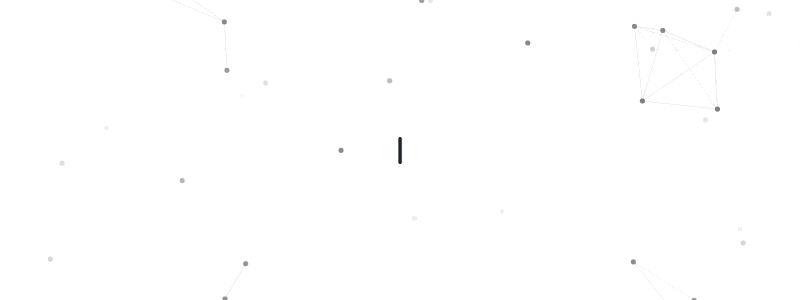
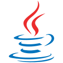
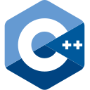

<!-- ======================================================================= -->
<!-- Header                                                                  -->
<!-- ======================================================================= -->

  <picture>
    <source media="(prefers-color-scheme: dark)" srcset="./assets/intro/hi_dark.gif">
    <source media="(prefers-color-scheme: light)" srcset="./assets/intro/hi_light.gif">
    
  </picture>

---

I'm a computer science & engineering student at the University of
[Instituto Superior Técnico](https://tecnico.ulisboa.pt/en/), Portugal.

I have a strong passion for software development, currently specializing in
**cybersecurity** and **Artificial Intelligence** with keen interest in
parallel computing.

I enjoy working on projects that challenge me and allow me to grow as a
developer.

<!-- ======================================================================= -->
<!-- Experience                                                              -->
<!-- ======================================================================= -->

## &nbsp; Experience

**Software Engineering Intern · [NAV Portugal ➚][nav-portugal]** 
Summer 2026 · Lisbon, Portugal

NAV Portugal provides air traffic services for Portuguese airspace. During my
internship I worked on its internal air traffic management tools, building a
viewer for SIGMETs: the official warnings about weather that is dangerous for
aircraft, such as thunderstorms, severe turbulence, icing or volcanic ash.
They arrive as compact coded text, and until then that was the only way to
read them. The viewer decodes each warning as it comes in and draws the
affected area on a live map of the airspace, so you can see where it is, at
what altitudes and until when at a glance.

I built it end to end, from the ICAO documentation that defines the message
format to the map itself, which reuses the base map of an existing NOTAM viewer.

`Python` `Flask` `Pydantic` `Apache ActiveMQ` `Apache Cassandra` `JavaScript` `OpenLayers` `Nginx` `Docker`

The code is internal to NAV Portugal and can't be shared, so this only covers what the project does and what it was built with.

<!-- ======================================================================= -->
<!-- Tech Stack & Tools                                                      -->
<!-- ======================================================================= -->

## &nbsp; Tech Stack & Tools

<table>
  <tr>
    <td><b>Core</b></td>
    <td>
      
      
      
    </td>
  </tr>
  <tr>
    <td><b>Languages</b></td>
    <td>
      
      
      
      
      
      
      
      
    </td>
  </tr>
  <tr>
    <td><b>AI & Data</b></td>
    <td>
      
      
      
      
      
      
    </td>
  </tr>
  <tr>
    <td><b>Systems & Security</b></td>
    <td>
      
      
      
      
    </td>
  </tr>
  <tr>
    <td><b>Backend & Databases</b></td>
    <td>
      
      
      
      
      
      
      
    </td>
  </tr>
  <tr>
    <td><b>Web & Graphics</b></td>
    <td>
      
      
      
      
      
      
      
    </td>
  </tr>
  <tr>
    <td><b>Tools</b></td>
    <td>
      
      
      
      
      
      
    </td>
  </tr>
</table>

<!-- ======================================================================= -->
<!-- Academic Journey                                                        -->
<!-- ======================================================================= -->

## &nbsp; Academic Journey

<!-- ----------------------------------------------------------------------- -->
<!-- Master's - Year 1                                                       -->
<!-- ----------------------------------------------------------------------- -->

<b> Master's Degree: Year 1 </b>

 

### Semester 2

| Project | Specialization · Subject | Description |
| :--- | :--- | :--- |
| **[multi-agent-traffic ➚][multi-agent-traffic]** | AI · Autonomous Agents and Multi-Agent Systems | A Python multi-agent simulation (Gymnasium) of a single-lane circular highway where autonomous and human-driven vehicles interact. Implemented and compared four coordination strategies ( random, greedy, spatial rule-based, and distributed Consensus-Based Control) measuring their effect on phantom traffic jams. The coordinated strategies sustained higher speed and flow up to ~50% autonomous-vehicle penetration, with Consensus-Based Control giving the most stable, smoothest wave recovery beyond that. |
| **[rusty-interpreter ➚][rusty-interpreter]** | Algorithms and Applications · Programming Languages | A tree-walking interpreter for a small functional-imperative language, built in Java with a JavaCC-generated parser. Evaluates the AST over an environment-and-store model, supporting closures, mutable reference cells, pattern matching over tagged tuples, and dynamic type checking with descriptive runtime errors. |
| **[rusty-interpreter-typed ➚][rusty-interpreter-typed]** | Algorithms and Applications · Programming Languages | The second phase of rusty-interpreter, where the language becomes statically typed: a type-checking pass now runs over the AST before evaluation. It supports type aliases and enum (labelled sum) types with width and depth subtyping, contravariant function arguments, invariant references, least-upper-bound typing for `if`/`match` branches, and exhaustiveness checks on `match`. I also did the three optional challenges: recursive types (aliases unfolded only when a comparison needs them), stack-allocated `let mut` variables with LIFO memory, and type-safe `&x` aliases, where an alias that would outlive its variable is rejected at type-checking time. |
| **[coverage-driven-testing-c ➚][coverage-driven-testing-c]** | Software Engineering · Software Testing and Validation | Put two third-party C data structures (a hash table and a red-black tree table) through the full testing toolchain: static analysis with Infer and clang-analyzer, fuzzing with AFL++, symbolic execution with KLEE, and dynamic analysis with Valgrind. Reported and fixed the memory-safety bugs found, then compared the coverage and bug-finding trade-offs between fuzzing and symbolic execution. |
| **[urban-delivery-test-suite ➚][urban-delivery-test-suite]** | Software Engineering · Software Testing and Validation | Black-box test design from a written specification of an urban delivery system in Java, choosing a strategy for each target. Order invariants: on/off boundary points and a domain matrix (non-modal class testing). Delivery lifecycle: a state machine and transition tree, plus every invalid call from each state (modal class testing, 39 cases). Delivery-cost rules: a decision table with domain matrices (combinational function testing), and state/input boundary analysis for `updateItem`. We implemented eight of the cases in TestNG against the given interfaces. No implementation of the system was provided, so the work is in designing the tests rather than running them. |
| **[dep-chain ➚][dep-chain]** | Cybersecurity · Highly Dependable Systems | A permissioned blockchain built in Java over a custom authenticated UDP link stack. Implements Basic HotStuff consensus with leader rotation and a timeout-based failure detector, hardened with per-vote RSA signatures and threshold (2f+1) quorum-certificate signatures. A second stage adds signed fee-paying transactions, a fee-ordered mempool, an ERC-20 token, and deterministic execution on the Hyperledger Besu EVM - tolerating up to *f* Byzantine replicas. |
| **[document-classification ➚][document-classification]** | Distributed Systems · Parallel and Distributed Computing | A document-clustering algorithm in C, parallelized three ways: SIMD (AVX intrinsics), shared-memory threading (OpenMP), and distributed memory (MPI). Profiled the sequential bottleneck with Intel VTune, then scaled the MPI version on the Deucalion supercomputer to a **475× speedup** at 512 tasks across 16 nodes. |
| **[markov-decision-models ➚][markov-decision-models]** | AI · Planning, Learning and Intelligent Decision Making | A series of Python assignments modelling a stochastic game under uncertainty with Markov chains, MDPs, and POMDPs. Implemented value and policy iteration, belief-state tracking, and MDP-based POMDP heuristics in NumPy, alongside the written derivations for stationary distributions, cost-to-go, and optimal policies. |

### Semester 1

| Project | Specialization · Subject | Description |
| :--- | :--- | :--- |
| **[ny-arrests-finance-kdd-pipeline ➚][ny-arrests-finance-kdd-pipeline]** | Artificial Intelligence · Data Science | An end-to-end KDD pipeline over two datasets (a ~5M-record NYPD arrests set and a financial-distress set), covering both classification and time-series forecasting. Built the full workflow: profiling, encoding, imputation, outlier handling, scaling, balancing (SMOTE and under-/over-sampling), and feature selection. Then trained and compared Naïve Bayes, KNN, Decision Trees, Random Forests, Gradient Boosting, and MLPs, prioritising recall on the heavily imbalanced target. The forecasting track compared persistence, rolling-mean, exponential smoothing, and ARIMA models. |
| **[neural-networks-theory-to-code ➚][neural-networks-theory-to-code]** | Artificial Intelligence · Deep Learning (DEI) | Deep-learning assignments spanning theory and implementation. Built classifiers for the Intel image dataset (6 scene categories) in NumPy (perceptron, logistic regression, and an MLP with hand-derived backpropagation) then as CNNs in PyTorch with batch normalization and global average pooling. Also implemented an LSTM sequence-to-sequence model with Bahdanau attention and nucleus (top-p) sampling, plus the derivations linking modern Hopfield networks to transformer attention. |
| **[clinical-specialty-classifier ➚][clinical-specialty-classifier]** | Artificial Intelligence · Natural Language | Classifies clinical notes into 12 medical specialties with TF-IDF features and linear models (scikit-learn), written up as a short paper. Much of the work was data analysis. Malformed quoting was silently merging records in the CSV, which we recovered by parsing the file line by line. The first keyword turned out to be the label itself, and 58% of records share their transcription with another record, almost always under a different label. That led to a routed model: a linear SVM on the keywords when a record has them, and logistic regression on the rest of the record when it doesn't. It reached 0.90 accuracy and 0.88 macro-F1 on validation, and most of the remaining errors are on records without keywords. We also tried a clinical version of EDA augmentation (sentence dropout, abbreviation swaps) for the rare classes. |
| **[eliza-explainer-video ➚][eliza-explainer-video]** | Artificial Intelligence · Natural Language | A short explainer video on ELIZA (Joseph Weizenbaum, MIT, 1966), one of the first chatbots. It shows how ELIZA kept a conversation going without understanding anything: keyword spotting, decomposition and reassembly rules, pronoun swaps ("I think my cat has powers" → "Why do you think your cat has powers?"), and generic fallbacks when nothing matched. All of this was framed as a Rogerian therapist reflecting the user's words back. The second half covers the ELIZA effect, Weizenbaum's own unease with it, and why it matters more now that chatbots answer in natural, expressive voices. Its closing point: *ELIZA didn't understand people. It simply made people feel understood.* |
| **[alien-tiles-csp ➚][alien-tiles-csp]** | Artificial Intelligence · Symbolic Explainable Artificial Intelligence | A Python and MiniZinc (Gecode) solver for Alien Tiles (CSPLib 027). Clicking a cell on an n×n board advances the colour of its whole row and column, and the goal is to reach a target board in the fewest clicks. We started from the direct model, with one variable per cell, and then reformulated it. Each cell's clicks follow from its row and column totals, so the solver only branches on 2n values instead of n² (on a 6×6 board with 3 colours, ~5×10⁵ combinations instead of ~10¹⁷). We added symmetry breaking for identical rows and columns and for diagonally symmetric goals, plus a benchmark that compares the models by solve time and search failures. It also has a terminal mode for playing the puzzle by hand. |
| **[civic-echo ➚][civic-echo]** | Cybersecurity · Network and Computer Security | A pseudo-anonymous civic-reporting platform spanning three segmented virtual networks (Java, Spring Boot, MariaDB, UFW firewalls). Designed a secure document protocol on top of standard RSA and AES-GCM: hybrid encryption, digital signatures, and a mediating central server that strips and re-signs reports to anonymise the citizen while preserving integrity and non-repudiation. A separate token server rate-limits submissions to curb spam and priority inflation. |
| **[py-vuln-analyzer ➚][py-vuln-analyzer]** | Cybersecurity · Software Security | A Python static-analysis (SAST) tool that detects taint-style vulnerabilities in web-application code. Parses the program's AST and tracks untrusted data from sources to sinks (through sanitizers, assignments, branches, and implicit control-flow flows) against fully customisable JSON vulnerability patterns. Ships with five real-world patterns: SQL injection, reflected XSS, command injection, path traversal, and unsafe deserialization. |
| **[tecnico-flag-hunter ➚][tecnico-flag-hunter]** | Cyber-security · Software Security | A portfolio of proof-of-concept exploits for web and binary challenges, written with Python (pwntools, requests), C, and GDB. Covers buffer overflows, format-string writes, blind and union-based SQL injection, stored/reflected XSS with WAF bypasses, TOCTOU race conditions, and insecure deserialization. It was exploited in a controlled lab setup (ASLR disabled, non-PIE binaries) to focus on the vulnerability mechanics. |
| **[memelgate-s1-artifact-steganalysis ➚][memelgate-s1-artifact-steganalysis]** | Cybersecurity · Forensics Cyber-Security | Part one of a three-stage forensics investigation. Recovered and analysed hidden artifacts tied to a credential-harvesting website, by cracking a password-protected archive with John the Ripper, carving embedded files with binwalk, and extracting data from images with zsteg, steghide, and LSB analysis, establishing the phishing scam and surfacing a parking-fraud lead. |
| **[memelgate-s2-filesystem-forensics ➚][memelgate-s2-filesystem-forensics]** | Cybersecurity · Forensics Cyber-Security | Part two: disk-image forensics on Kali Linux. Reconstructed how the phishing site was built and operated from system artifacts (Firefox history, Thunderbird mail, IRC logs, bash history, systemd journal), decompiled and reverse-engineered the attacker's obfuscated Python to crack encrypted backup archives, recovered a KeePass vault, and identified anti-forensic activity such as secure deletion. |
| **[memelgate-s3-network-exfiltration ➚][memelgate-s3-network-exfiltration]** | Cybersecurity · Forensics Cyber-Security | Part three: network forensics in Wireshark. Followed TCP streams and exported objects across several packet captures, decrypted TLS traffic with a provided key-log file, and traced an FTP brute-force and data-exfiltration chain. This way we reconstructed the timeline that connected the captured traffic to the wider parking-fraud and phishing scheme. |
| **[sdht-protocol-alloy ➚][sdht-protocol-alloy]** | Software Engineering · Software Specification | A formal Alloy model of a distributed hash-table protocol: a ring of servers with clients that connect and disconnect dynamically, store/find operations, and message passing via inboxes and outboxes. Specified the structural invariants and checked safety (at most one server holds each key) and liveness/termination assertions with Alloy's bounded model checker. |
| **[dafny-math-and-stack ➚][dafny-math-and-stack]** | Software Engineering · Software Specification | Formally verified algorithms and a data structure in Dafny, proved correct by its SMT backend. Includes the algorithm double-and-halve multiplication, fast exponentiation, and prefix sums (carried by loop invariants and supporting lemmas) plus a pointer-based Stack class specified entirely through pre- and post-conditions. |

<!-- ----------------------------------------------------------------------- -->
<!-- Bachelor's - Year 3                                                     -->
<!-- ----------------------------------------------------------------------- -->

<b> Bachelor's Degree: Year 3</b>

 

### Semester 2

| Project Name | Subject |
| :--- | :--- |
| **[Fix #11075 dropdown reload in LinkAvatarChip ➚][twenty-12278]** | 1st Cycle Integrated Project in Computer Science and Engineering |
| **[Fix #7429: Prevent stuck keys when game window loses focus ➚][gdevelop-7753]** | 1st Cycle Integrated Project in Computer Science and Engineering |
| **[feat: add actions to set max and min FPS at runtim #7754 ➚][gdevelop-7754]** | 1st Cycle Integrated Project in Computer Science and Engineering |
| **[HumanaEthica-ES ➚][HumanaEthica-ES]** | Software Engineering |
| **[tuple-spaces ➚][tuple-spaces]** | Distributed Systems |
| **[til-compiler ➚][til-compiler]** | Compilers |
| **[sketch-graph-3d ➚][sketch-graph-3d]** | Computer Graphics |
| **[threejs-crane-simulator ➚][threejs-crane-simulator]** | Computer Graphics |
| **[threejs-math-carousel-vr ➚][threejs-math-carousel-vr]** | Computer Graphics |
| **---** | Climate Crisis and Just Transition (HASS I) |
| **---** | Introduction to Architecture ( HASS II ) |

### Semester 1

| Project Name | Subject |
| :--- | :--- |
| **[machine-learning-theory-and-programming ➚][machine-learning-theory-and-programming]** | Machine Learning |
| **[multi-level-cache-simulator ➚][multi-level-cache-simulator]** | Computer Organization |
| **[cache-modeling-and-performance-profiling ➚][cache-modeling-and-performance-profiling]** | Computer Organization |
| **[assembly-hazard-minimization ➚][assembly-hazard-minimization]** | Computer Organization |
| **[super-shop-system-architecture-design ➚][super-shop-system-architecture-design]** | Systems Analysis and Modeling |
| **[auction-platform ➚][auction-platform]** | Computer Networks |

<!-- ----------------------------------------------------------------------- -->
<!-- Bachelor's - Year 2                                                     -->
<!-- ----------------------------------------------------------------------- -->

<b> Bachelor's Degree: Year 2</b>

 

### Semester 2

| Project Name | Subject |
| :--- | :--- |
| **[ArturKrys/r-stochastic-simulations-and-modeling ➚][r-stochastic-simulations-and-modeling]** | Probability and Statistics |
| **[timebanking-mobile-prototype ➚][timebanking-mobile-prototype]** | Human-Computer Interaction |
| **[dense-ui-target-optimizer ➚][dense-ui-target-optimizer]** | Human-Computer Interaction |
| **---** | Theory of Computation |
| **[online-retail-db-system ➚][online-retail-db-system]** | Databases |
| **[bimaru-solver ➚][bimaru-solver]** | Artificial Intelligence |

### Semester 1

| Project Name | Subject |
| :--- | :--- |
| **---** | Differential and Integral Calculus III |
| **---** | Physics II |
| **[veterinary-hotel-manager ➚][veterinary-hotel-manager]** | Object-Oriented Programming |
| **[tile-combination-calculator ➚][tile-combination-calculator]** | Analysis and Synthesis of Algorithms |
| **[adapted-kruskal ➚][adapted-kruskal]** | Analysis and Synthesis of Algorithms |
| **[concurrent-fs-bessage-broker ➚][concurrent-fs-bessage-broker]** | Operating Systems |

<!-- ----------------------------------------------------------------------- -->
<!-- Bachelor's - Year 1                                                     -->
<!-- ----------------------------------------------------------------------- -->

<b> Bachelor's Degree: Year 1</b>

 

### Semester 2

| Project Name | Subject |
| :--- | :--- |
| **---** | Differential and Integral Calculus II |
| **---** | Physics I |
| **[public-transit-manager ➚][public-transit-manager]** | Introduction to Algorithms and Data Structures |
| **---** | Elements of Discrete Mathematics |
| **[16bit-assembly-space-game ➚][16bit-assembly-space-game]** | Introduction to Computer Architecture |

### Semester 1

| Project Name | Subject |
| :--- | :--- |
| **---** | Differential and Integral Calculus I |
| **---** | Linear Algebra |
| **[python-go-boardgame ➚][python-go-boardgame]** | Foundations of Programming |
| **---** | Introduction to Information Systems and Computer Engineering |
| **---** | Management |
| **[prolog-hashi-solver ➚][prolog-hashi-solver]** | Logic for Programming |

<!-- ======================================================================= -->
<!-- Footer note                                                             -->
<!-- ======================================================================= -->

>  **A Note on Academic Projects:** These repositories represent my learning journey through my degree. They showcase my progress, ranging from early experiments to some good implementations. Fellow students are welcome to explore and use this code for inspiration, but please remember to critically evaluate it for your own use cases.

<!-- ======================================================================= -->
<!-- Link references                                                         -->
<!-- ======================================================================= -->

<!-- Experience -->
[nav-portugal]: https://www.nav.pt/

<!-- Master's - Year 1 -->
[multi-agent-traffic]: https://github.com/ArturKrys/multi-agent-traffic
[rusty-interpreter]: https://github.com/ArturKrys/rusty-interpreter
[rusty-interpreter-typed]: https://github.com/ArturKrys/rusty-interpreter-typed
[coverage-driven-testing-c]: https://github.com/ArturKrys/coverage-driven-testing-c
[urban-delivery-test-suite]: https://github.com/ArturKrys/urban-delivery-test-suite
[dep-chain]: https://github.com/ArturKrys/dep-chain
[document-classification]: https://github.com/ArturKrys/document-classification
[markov-decision-models]: https://github.com/ArturKrys/markov-decision-models
[ny-arrests-finance-kdd-pipeline]: https://github.com/ArturKrys/ny-arrests-finance-kdd-pipeline
[neural-networks-theory-to-code]: https://github.com/ArturKrys/neural-networks-theory-to-code
[clinical-specialty-classifier]: https://github.com/ArturKrys/clinical-specialty-classifier
[eliza-explainer-video]: https://youtu.be/FXx0FY4bEPU
[alien-tiles-csp]: https://github.com/ArturKrys/alien-tiles-csp
[civic-echo]: https://github.com/ArturKrys/civic-echo
[py-vuln-analyzer]: https://github.com/ArturKrys/py-vuln-analyzer
[tecnico-flag-hunter]: https://github.com/ArturKrys/tecnico-flag-hunter
[memelgate-s1-artifact-steganalysis]: https://github.com/ArturKrys/memelgate-s1-artifact-steganalysis
[memelgate-s2-filesystem-forensics]: https://github.com/ArturKrys/memelgate-s2-filesystem-forensics
[memelgate-s3-network-exfiltration]: https://github.com/ArturKrys/memelgate-s3-network-exfiltration
[sdht-protocol-alloy]: https://github.com/ArturKrys/sdht-protocol-alloy
[dafny-math-and-stack]: https://github.com/ArturKrys/dafny-math-and-stack

<!-- Bachelor's - Year 3 -->
[twenty-12278]: https://github.com/twentyhq/twenty/pull/12278
[gdevelop-7753]: https://github.com/4ian/GDevelop/pull/7753
[gdevelop-7754]: https://github.com/4ian/GDevelop/pull/7754
[HumanaEthica-ES]: https://github.com/ArturKrys/HumanaEthica-ES
[tuple-spaces]: https://github.com/ArturKrys/tuple-spaces
[til-compiler]: https://github.com/ArturKrys/til-compiler
[sketch-graph-3d]: https://github.com/ArturKrys/sketch-graph-3d
[threejs-crane-simulator]: https://github.com/ArturKrys/threejs-crane-simulator
[threejs-math-carousel-vr]: https://github.com/ArturKrys/threejs-math-carousel-vr
[machine-learning-theory-and-programming]: https://github.com/ArturKrys/machine-learning-theory-and-programming
[multi-level-cache-simulator]: https://github.com/ArturKrys/multi-level-cache-simulator
[cache-modeling-and-performance-profiling]: https://github.com/ArturKrys/cache-modeling-and-performance-profiling
[assembly-hazard-minimization]: https://github.com/ArturKrys/assembly-hazard-minimization
[super-shop-system-architecture-design]: https://github.com/ArturKrys/super-shop-system-architecture-design
[auction-platform]: https://github.com/ArturKrys/auction-platform

<!-- Bachelor's - Year 2 -->
[r-stochastic-simulations-and-modeling]: https://github.com/ArturKrys/r-stochastic-simulations-and-modeling
[timebanking-mobile-prototype]: https://github.com/ArturKrys/timebanking-mobile-prototype
[dense-ui-target-optimizer]: https://github.com/ArturKrys/dense-ui-target-optimizer
[online-retail-db-system]: https://github.com/ArturKrys/online-retail-db-system
[bimaru-solver]: https://github.com/ArturKrys/bimaru-solver
[veterinary-hotel-manager]: https://github.com/ArturKrys/veterinary-hotel-manager
[tile-combination-calculator]: https://github.com/ArturKrys/tile-combination-calculator
[adapted-kruskal]: https://github.com/ArturKrys/adapted-kruskal
[concurrent-fs-bessage-broker]: https://github.com/ArturKrys/concurrent-fs-bessage-broker

<!-- Bachelor's - Year 1 -->
[public-transit-manager]: https://github.com/ArturKrys/public-transit-manager
[16bit-assembly-space-game]: https://github.com/ArturKrys/16bit-assembly-space-game
[python-go-boardgame]: https://github.com/ArturKrys/python-go-boardgame
[prolog-hashi-solver]: https://github.com/ArturKrys/prolog-hashi-solver
